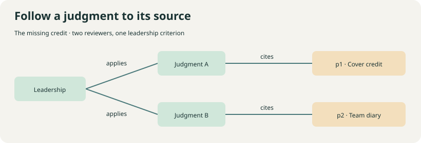

# On Second Read

**[Play the hosted casebook](https://marouaneoa.github.io/On-Second-Read/)**

Try [What would change your mind?](https://marouaneoa.github.io/On-Second-Read/#request-a-document) to request one record before reading the full pantry case. In [Repair the rubric](https://marouaneoa.github.io/On-Second-Read/#repair-the-rubric), remove one RDF triple and inspect how the outside-rubric SPARQL result changes.

Start with the library practice excerpt. Choose a phrase, reveal the ontology links, and compare your choice with the worked Codex answer or a live model. Saved comparisons and reflections stay in your browser.

Choose a case and open **Explore ontology** to navigate classes or case-specific evidence. The **LLM workbench** can send a dossier directly from your browser to a provider using your personal key, or inspect a JSON response pasted from another model. The browser compares proposed wording with the original review and resolves passage IDs. Assess the meaning of each citation yourself.

A playable evidence casebook and a local LLM annotation studio. Investigate the authored cases below, or [extract and review a graph from your own dossier](#annotation-studio).

Two reviewers assess the same portfolio. One reads the cover credit. The other reads the team diary. Before you open their evidence table, can you tell which conclusion you would revisit?

**[Download the playable browser edition](https://github.com/marouaneoa/On-Second-Read/raw/refs/heads/main/docs/index.html)** · Open the downloaded HTML file in your browser. It works offline.

Read both reviews, commit to a finding and a supporting reason, then inspect the source trace. In the evidence lab, change Reviewer B’s citation or criterion to see which SPARQL results appear or disappear. Progress is saved in your browser when storage is available.

[Play the Markdown edition on GitHub](cases/missing-credit/README.md)

| Case | Your question |
| --- | --- |
| [The moving goalpost](cases/moving-goalpost/README.md) | Where did a new requirement enter the decision? |
| [Different words, same reasoning](cases/same-reasoning/README.md) | How much does the wording change the evidence trail? |
| [The night shift](cases/the-night-shift/README.md) | Did anyone accept responsibility for the faulty stage light? |
| [Whose words count?](cases/whose-words/README.md) | What does a visitor collecting a ticket tell us about the writer? |

Read the dossier and both reviews, make a prediction, then expand the reveal. Every row comes from a query you can inspect. These original fictional cases explore consistency in hiring reviews. They support questions about the documented reasoning. Establishing a reviewer’s intent requires additional evidence.

## Inside the graph

A case lists criteria and has reviews. Each review contains a judgment. Giving the judgment its own identifier lets us attach the criterion and cited passage to that particular assessment, even when one review makes several claims. The passage carries the exact quotation and points to its source document.



Explore the [OWL vocabulary in Turtle](ontology/review.ttl) and the [first case’s individuals](cases/missing-credit/data.ttl). In Protégé, open the vocabulary and browse **Entities → Classes** and **Object properties**. For a combined view, run the following after setup, open the resulting Turtle file in Protégé, and select **Individuals by class → Judgment**. Inspect the property assertions for judgment B.

```bash
python -c "from casebook import ROOT, load; load(ROOT/'cases/missing-credit').serialize('missing-credit-view.ttl', format='turtle')"
```

## Reproduce a reveal

From a checkout, create a Python environment and install RDFLib. The following commands use a Linux, WSL or macOS shell.

```bash
python3 -m venv .venv
source .venv/bin/activate
python -m pip install -r requirements.txt
python casebook.py missing-credit
```

Run `python casebook.py all --write` to refresh the five Markdown reveals. Run `python -m unittest discover -s tests -v` to check the expected answers and try a citation change in memory.

## Reading the results

The [four SPARQL queries](queries/) trace sources, compare citations under a shared criterion, find judgments outside the rubric, and identify shared citations under different wording. The runner loads one case at a time. Each fictional rubric explicitly lists all its criteria. That completeness assumption lets the outside-rubric query use absence as evidence. In a partial record, a missing entry would leave the question open. Shared citations establish overlap in the recorded evidence. Two people can cite the same passage and interpret it differently.

For a reader check, pick a judgment and locate its exact quotation in the dossier. What could you conclude from the case, and what would you still need to know?

Code, ontology, case texts and illustration are available under the [MIT License](LICENSE).

## Build the browser edition

Run `python build_web.py` after editing the RDF, queries or files in `web/`. The builder runs all four SPARQL queries against each supported citation/criterion combination and embeds the results in `docs/index.html`. Hypothetical edits apply to Reviewer B’s recorded links. Their original statement stays visible for comparison. Browser play requires no Python or server. To serve the artifact over HTTP locally, run `python -m http.server 8000 --directory docs` and open `http://localhost:8000`.

## Annotation studio

What happens when a language model has to justify every proposed graph edge against the actual dossier? The studio turns this into a repeatable annotation experiment. The public game contains authored examples. The local studio accepts new dossiers, calls a local model, and lets you review its proposed judgments before compiling them to OWL individuals.

From the repository root, with the Python dependencies installed, run:

```bash
python studio.py
```

Open **http://127.0.0.1:8765**. To explore immediately, choose *The moving goalpost*, load the authored annotations, then accept the reviewed set. Inspect the outside-rubric row and download the Turtle graph for Protégé. Edit Reviewer B’s criterion to `Delivery` and accept again to see that row disappear.

### Use a real model

Install [Ollama](https://ollama.com/download) and start its local service. With the service running, fetch the default model once:

```bash
ollama pull qwen2.5:3b
```

Choose **Local · Ollama** and click **Propose judgments**. To use another installed model, launch the studio with `OSR_MODEL=your-model-name python studio.py`. The model receives the dossier and the OWL vocabulary. The request uses [Ollama structured outputs](https://docs.ollama.com/capabilities/structured-outputs) to propose reviewer, wording, criterion and passage fields. Reference answers are excluded from the request.

1. Edit the dossier JSON to supply a complete rubric, identified source passages and named reviews.
2. Review each proposed link. A valid passage ID shows that a passage exists. Deciding whether it supports the judgment requires reading it.
3. Correct or remove unsupported proposals. Accepting the set checks the reviewer, exact excerpt, passage ID, and duplicate rows. The model can omit a judgment entirely, so also compare against the original reviews.
4. Inspect the four SPARQL results. The Turtle download contains the ontology, source text, judgments and an annotation activity identifying the origin of the reviewed set. Download each version you want to keep before changing dossiers.

### Measure extraction quality

```bash
python evaluate.py
python evaluate.py --live > evaluation.json
```

The first command runs a deterministic baseline that assigns the first rubric criterion and first passage to every review. It matches **6 of 10** authored judgments. The second compares the configured Ollama model against the same references. Each judgment is scored as an exact tuple of reviewer, excerpt, criterion and passage ID. The JSON reports per-case matches, extras and omissions plus micro precision, recall and F1. A synonymous criterion label or shorter accurate excerpt can therefore count as a miss. These ten judgments are a debugging benchmark. To estimate generalization, author independent cases and keep their labels out of prompt development.

### Use an OpenAI API key

The studio also supports OpenAI Chat Completions with [structured outputs](https://developers.openai.com/api/docs/guides/structured-outputs). In a Bash terminal with the project environment active, enter your key at the hidden prompt and start the server:

```bash
read -rsp 'OpenAI API key: ' OPENAI_API_KEY && echo
export OPENAI_API_KEY
python studio.py
```

Restart any existing studio process first so it receives the environment variable. At **http://127.0.0.1:8765**, choose **Hosted · OpenAI API** and click **Propose judgments**. This sends the dossier and ontology to OpenAI and uses your account’s API credit. The Python server reads the key from its environment. To select a different model that supports strict JSON Schema, set `OSR_OPENAI_MODEL` before startup (default `gpt-4o-mini`).

For the five-case benchmark, run `python evaluate.py --live --provider openai` with the same environment. Local Ollama remains the default.

### Use OpenRouter or Google Gemini

Choose either provider in the same studio dropdown. Set its server-side key before launching the studio or benchmark.

| Provider | Key variable | Optional model override | Default model |
| --- | --- | --- | --- |
| OpenRouter | `OPENROUTER_API_KEY` | `OSR_OPENROUTER_MODEL` | `openai/gpt-4o-mini` |
| Google Gemini | `GEMINI_API_KEY` | `OSR_GEMINI_MODEL` | `gemini-3.8-flash` |

For example, in Bash:

```bash
read -rsp 'OpenRouter key: ' OPENROUTER_API_KEY && echo
export OPENROUTER_API_KEY
python studio.py
```

For Gemini, use `GEMINI_API_KEY` in both shell commands. Restart the studio after changing keys or model settings. For a benchmark run use `python evaluate.py --live --provider openrouter` or `python evaluate.py --live --provider gemini`. Each request sends the dossier and ontology through the selected service. Choose models that support structured JSON output. See the [OpenRouter schema guide](https://openrouter.ai/docs/guides/features/structured-outputs) and [Gemini schema guide](https://ai.google.dev/gemini-api/docs/structured-output).
